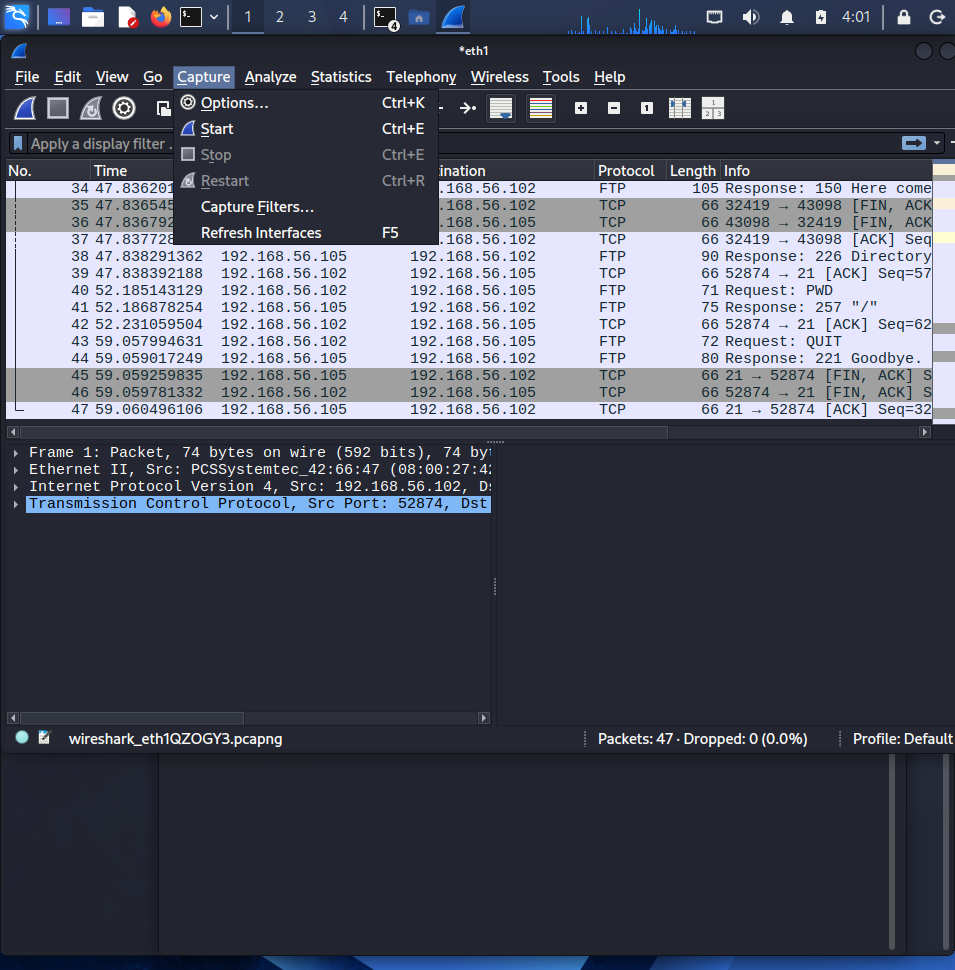
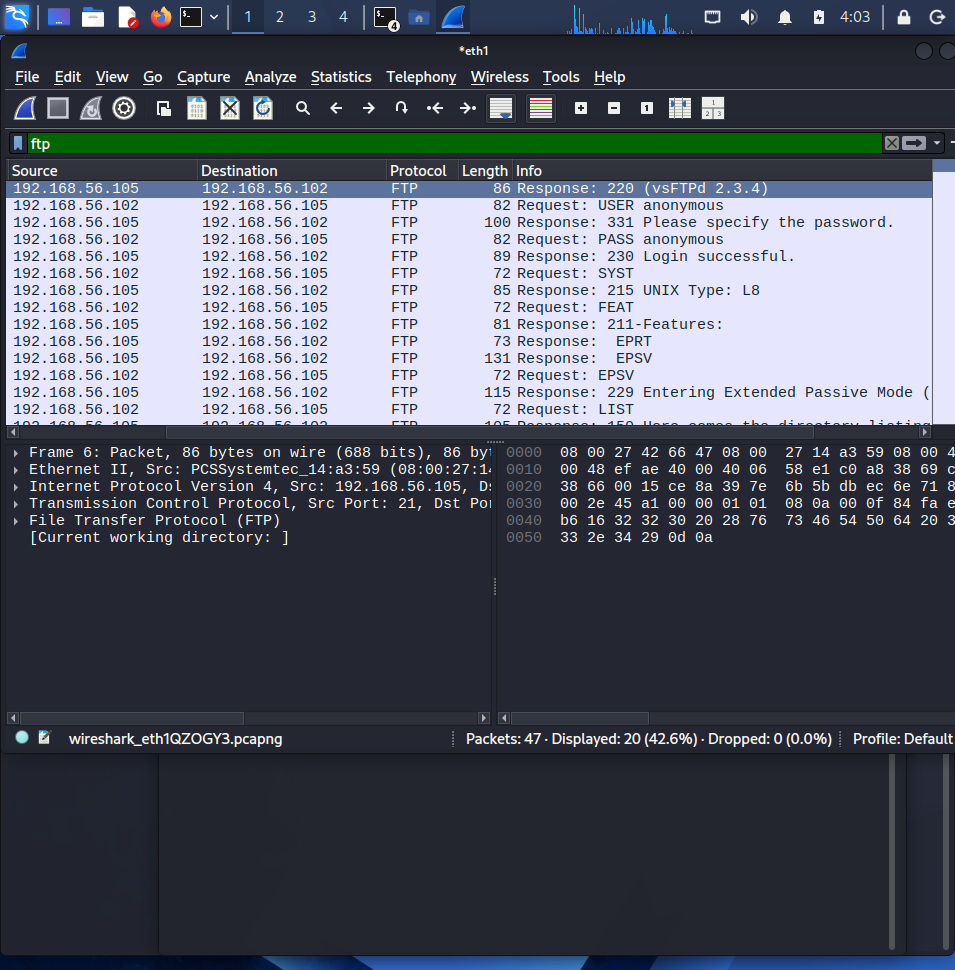
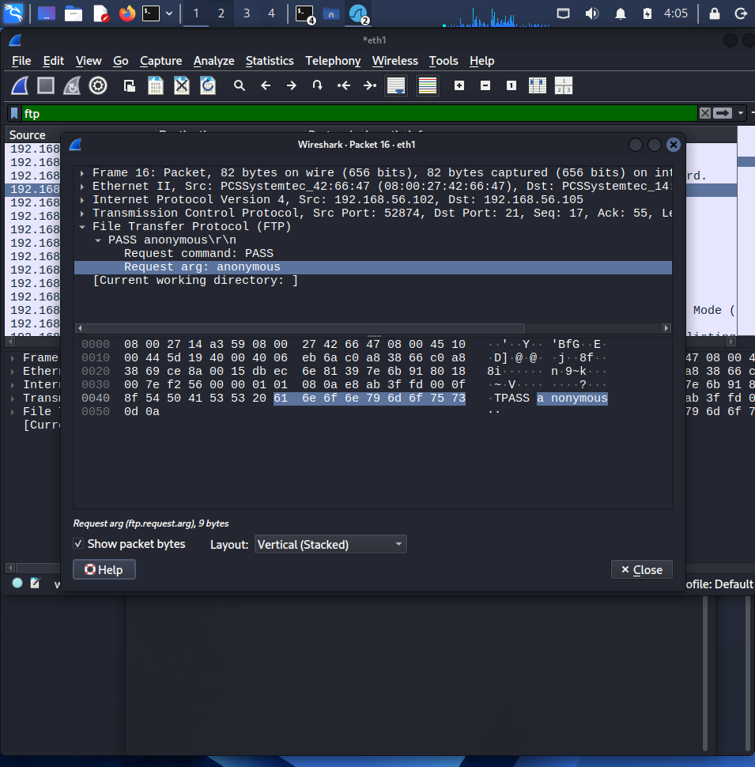

# Wireshark FTP Traffic Analysis — Cleartext Credential Exposure

I captured and analyzed live network traffic between my Kali attacker machine and Metasploitable2, focusing on an FTP login session. The capture shows exactly how an unencrypted protocol exposes credentials in plain, readable text to anyone who can observe the traffic. Run entirely in an isolated lab, VirtualBox host-only network, no external access.

## Lab Setup

| Role | OS | IP Address |
|---|---|---|
| Observer / Client | Kali Linux | 192.168.56.102 |
| Target | Metasploitable2 | 192.168.56.105 |

## What I Did

### 1. Started a packet capture

I opened Wireshark on Kali and started capturing on `eth1`, the interface on the same subnet as the target.

```
sudo wireshark
```

### 2. Generated FTP traffic

While the capture was running, I connected to Metasploitable's FTP service from a separate terminal and logged in:

```
ftp 192.168.56.105
```

I authenticated with `anonymous` / `anonymous`, ran a couple of commands (`ls`, `pwd`), then disconnected with `quit`.

### 3. Filtered the capture to FTP traffic

Back in Wireshark, I applied a display filter to isolate just the FTP control channel, cutting out all other noise:

```
ftp
```

This showed the entire session cleanly — the banner, login exchange, directory listing request, and clean disconnect.



### 4. Reviewed the full session, including teardown

Beyond the login, the capture also shows the session's natural end — the `QUIT` command, the server's goodbye response, and the TCP connection teardown (FIN/ACK packets in both directions).



### 5. Inspected the credentials at the byte level

I clicked into the specific `PASS anonymous` packet to look at the raw data. Wireshark's packet detail pane showed the FTP protocol layer with `Request command: PASS` and `Request arg: anonymous` spelled out directly — no decoding or decryption needed. The hex/ASCII view at the bottom confirmed the same thing at the byte level: the password is sitting there in plain text, readable to anyone capturing this traffic.



## What This Shows

FTP (and other legacy protocols like Telnet and HTTP without TLS) sends everything — including usernames and passwords — as unencrypted plain text over the network. Anyone positioned to observe traffic between a client and server (on a shared network, a compromised switch, or via a man-in-the-middle position) can capture these credentials with nothing more than a packet sniffer and zero cracking or decryption effort.

This isn't a vulnerability in the traditional sense — it's how these protocols were designed decades ago, before encryption was standard practice. But it's a real and still-common finding in network security assessments, especially on older or poorly maintained infrastructure.

## How I'd Fix It

- Replace FTP with a secure alternative: SFTP (SSH File Transfer Protocol) or FTPS (FTP over TLS)
- Replace Telnet with SSH
- Enforce TLS/SSL on any service handling credentials or sensitive data
- Segment networks so unencrypted traffic isn't exposed beyond what's strictly necessary
- Monitor for cleartext authentication protocols as a standing finding in security audits

## Disclaimer

I captured this traffic exclusively within an isolated lab network, between machines I own and control, with Metasploitable2 — a VM intentionally built for legal security training. Capturing network traffic you don't have authorization to observe, on networks you don't own or have explicit permission to test, is illegal in most jurisdictions.
